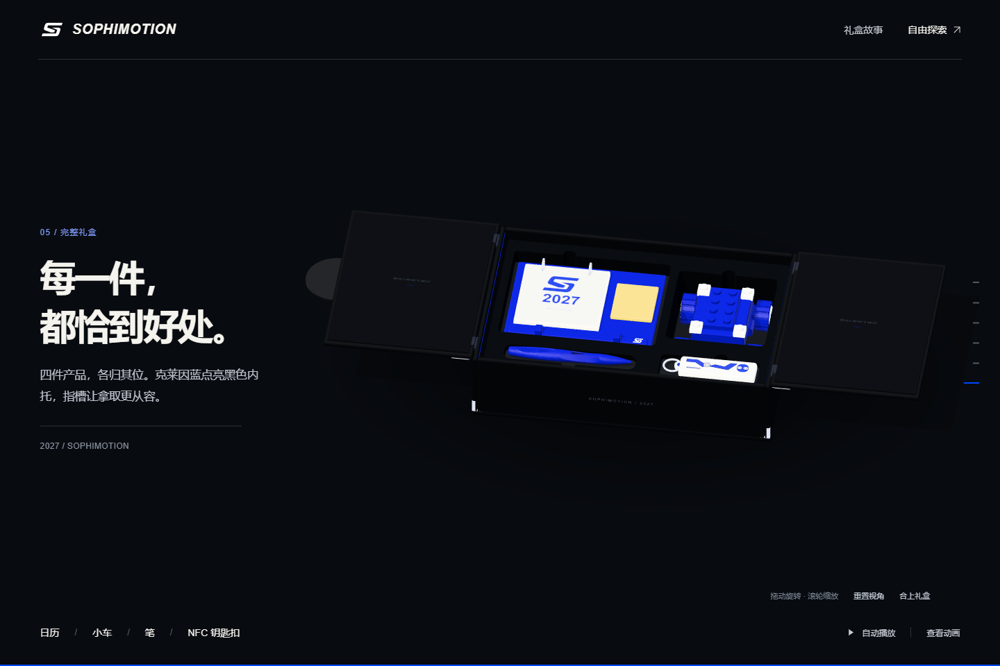

# SOPHIMOTION 2027 灵感礼盒

[浏览网站](https://sytt198.github.io/sophimotion-2027-gift/) · [观看 14 秒动画](https://sytt198.github.io/sophimotion-2027-gift/assets/2027-gift-box.mp4)

黑色礼盒、银色完整 S、克莱因蓝产品。向下滚动展开双翼盒盖，再逐件探索日历、小车、3D 打印笔与 NFC 钥匙扣。内托使用局部指槽，无拉带。



## 功能

- 双翼各向外打开 180°，左盖先开、右盖先合，完整 S 始终随左盖移动。
- 滚动章节、自动播放/暂停、自由旋转和缩放。
- 四件产品独立查看、重置视角、重新开合。
- 桌面和手机适配，键盘控制，支持系统减少动态效果设置。
- 14 秒、1080p、30 fps 的无声动画，可直接播放和下载。

## 本地运行

需要 Node.js 22 或更高版本。网站运行无需安装依赖：

```bash
git clone https://github.com/sytt198/sophimotion-2027-gift.git
cd sophimotion-2027-gift
npm start
```

打开 http://127.0.0.1:5197 。Windows 也可双击 `打开礼盒网页.cmd`。请使用 HTTP 服务，不要直接以 file:// 打开 HTML。

## 检查

```bash
npm run check
```

可选浏览器验收：

```bash
npm ci
npx playwright install chromium
# 在另一终端保持 npm start 运行
npm run test:browser
```

`CHROME_PATH` 可指定现有 Chrome 可执行文件，`TEST_URL` 可覆盖默认的本地测试地址。

## 目录

| 路径 | 内容 |
|---|---|
| `dist/` | 可直接部署的完整网站，无运行时 CDN 依赖 |
| `dist/gift-scene.js` | 共享三维场景、盒盖机构、内托、产品与相机动画 |
| `dist/assets/` | GLB 模型、品牌图形、MP4 及封面 |
| `animation/` | 可编辑的 HyperFrames 动画项目 |
| `scripts/` | 本地服务、模型导出与验证、动画同步、浏览器检查 |
| `.github/workflows/pages.yml` | 推送到 main 后自动发布 GitHub Pages |

## 重新渲染动画

```bash
npm run video:sync
cd animation
npm run render -- --fps 30 --quality high --crf 22 --workers 2 --output ../dist/assets/2027-gift-box.mp4
```

如需使用已安装的 Chrome，请在环境变量 `HYPERFRAMES_BROWSER_PATH` 中指定可执行文件。详见 [动画说明](animation/README.md)。

## 模型与设计依据

笔使用真实 CAD 网格，长度 141 mm。小车保留实际模型的底壳与轮位，并按产品效果图补齐蓝白积木外观；完整外包约 101 × 108 × 60.64 mm。外盒方案尺寸为 342 × 232 × 86 mm。日历、NFC 壳、内托和开盖机构属于展示方案，生产前需要包装打样。

网页运行所需 GLB 已包含。原始 STEP 文件不属于运行依赖；若持有原文件，可用 `python scripts/export_gift_cad.py --help` 查看重新导出方式。

交互参考 [Badge Factory](https://hervestudio.github.io/badge-factory/) 的滚动组装叙事，未复制其徽章资产或品牌。第三方组件说明见 [THIRD_PARTY_NOTICES.md](THIRD_PARTY_NOTICES.md)。
